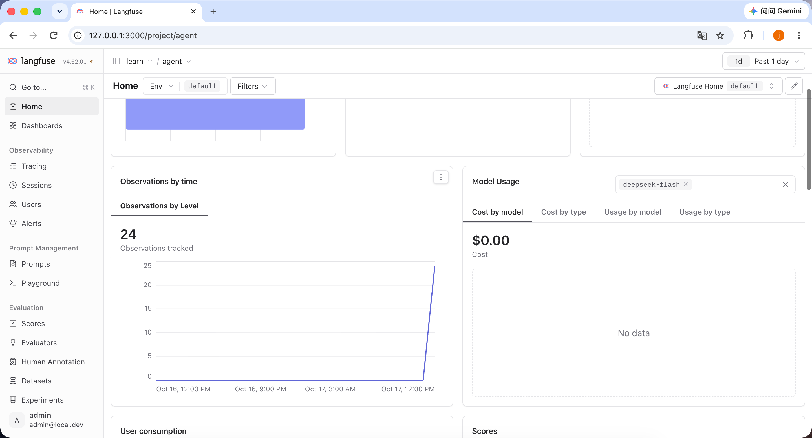
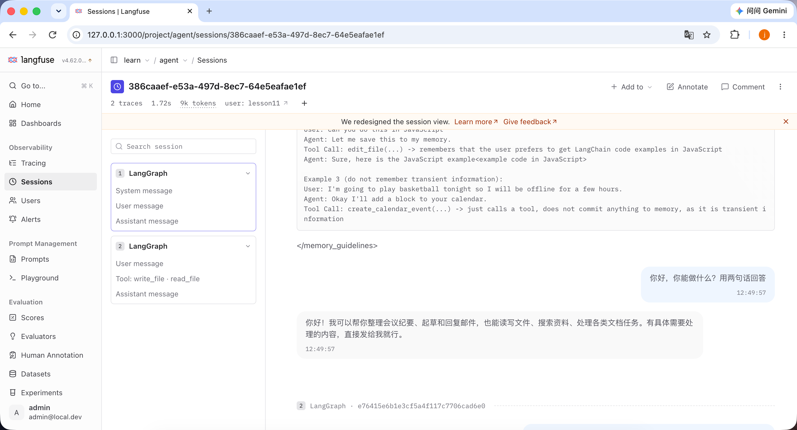

### langfuse：给第八课的 deepagents 装上追踪和考试

前面一直在「写」agent。写完之后有两个问题绕不开：

1. 它刚才到底干了什么？
2. 我改了提示词，它是变好了还是变坏了？

这一章用 langfuse（[文档](https://langfuse.com/docs)）回答这两个问题，分两部分：**一、观测**看它每一步干了什么，**二、评测**用固定题目给它打分。被测对象是**第 8 课的 deepagents agent**：虚拟文件系统 + 技能 + 记忆，没有 `execute`。第 8 课的代码一行没动。

### 本地部署 langfuse

还是 docker 本机跑，配置在 `src/lesson11/langfuse/`。web 只绑 `127.0.0.1:3000`，用 `LANGFUSE_INIT_*` 初始化组织、项目和 key，不注册云账号。

```sh
colima start -p langfuse --cpu 4 --memory 6 --disk 40
cd src/lesson11/langfuse
docker compose up -d
```

打开 `http://127.0.0.1:3000`，用本地邮箱密码登录。

## 一、观测

### 怎么接

都在 `src/lesson11/tracing.py` 和 `main.py` 里。

**1. 环境变量。** langfuse 的 SDK 只认三个变量：地址、公钥、私钥。这里直接取 docker 初始化用的那份 key：

```python
_lf = dotenv_values(HERE / "langfuse" / ".env")
os.environ.setdefault("LANGFUSE_BASE_URL", "http://127.0.0.1:3000")
os.environ.setdefault("LANGFUSE_PUBLIC_KEY", _lf.get("LANGFUSE_INIT_PROJECT_PUBLIC_KEY") or "")
os.environ.setdefault("LANGFUSE_SECRET_KEY", _lf.get("LANGFUSE_INIT_PROJECT_SECRET_KEY") or "")
```

**2. 回调挂进 config。** 第 8 课的 `Agent` 每次调用图都会拿 `self.config()`，继承它、改一下 `config()` 就行：

```python
class Agent(Lesson8Agent):
    def __init__(self, context_id: str):
        super().__init__(context_id, GRAPH, FS)

    def config(self):
        config = super().config()
        config["callbacks"] = [CallbackHandler()]
        config["metadata"] = {
            "langfuse_session_id": self.context_id,
            "langfuse_user_id": "lesson11",
            "langfuse_tags": ["lesson11", "deepagents"],
        }
        return config
```

**3. 元数据。** `metadata` 里 `langfuse_` 开头的三个键会变成 trace 的 session、user、tags。session 用 `context_id`，同一个会话的几轮对话就归到一个 session 下面。

**4. 退出前 flush。** trace 是后台批量发的，进程退出前要推干净。FastAPI 用 `lifespan`：

```python
@asynccontextmanager
async def lifespan(app: FastAPI):
    yield
    # 退出前把还没发出去的 trace 推给 langfuse
    langfuse().flush()


app = FastAPI(lifespan=lifespan)
```

对外还是 `/create_context`、`/stream_chat`，前端不用改。接通以后，首页就能看到观测数和模型用量：



图里一轮测试共 24 个观测，模型是 `deepseek-flash`。花费是 $0.00，因为 langfuse 里没有给这个模型配价格。

### 原理

**回调跟着 config 往下传。** LangChain / LangGraph 里，传给 `invoke` / `stream` 的 config 会一路带到每个子节点：图本身、每个中间件、模型节点、工具调用。每一步开始和结束都会调 `callbacks` 里的方法，并带上自己的 `run_id` 和父节点的 `parent_run_id`。

`CallbackHandler` **把回调翻成观测。** 源码在 `langfuse/langchain/CallbackHandler.py`，主要是这几对：

- `on_chain_start` / `on_chain_end`：开、关一个 `CHAIN`；名字或类路径里带 `agent` 的记成 `AGENT`；
- `on_chat_model_start` / `on_llm_end`：开、关一个 `GENERATION`，带模型名和 token 用量；
- `on_tool_start` / `on_tool_end`：开、关一个 `TOOL`，带输入输出。

开新观测时，用 `parent_run_id` 找到父观测，挂在它下面，所以 langfuse 里看到的树就是图的调用结构。`parent_run_id` 为空的是根节点，这时它从 `metadata` 里取出 `langfuse_session_id` / `user_id` / `tags`，设到整条 trace 上。

**每个观测就是一个 OpenTelemetry span。** langfuse 的 SDK 底下是 OTel：span 结束后先进队列，后台线程攒一批再发到 `LANGFUSE_BASE_URL`。所以请求返回时数据不一定已经发出去，进程退出前要 `flush()`。

### 调用结果

一个会话里问两句：「你好，你能做什么？用两句话回答」，再让它在 `/workspace/note.txt` 写一行 `hello-langfuse` 并读出来。langfuse 里是一个 session、两条 trace：



左边每条 trace 的根都是 `LangGraph`，第二条里能看到 `Tool: write_file · read_file`；右边按对话顺序展开系统提示、用户消息和回答。

第二条 trace 展开是这样的（中间件观测省略）：

```text
CHAIN LangGraph                       2.22s
  CHAIN model → GENERATION ChatOpenAI  0.89s  deepseek-flash
  CHAIN tools → TOOL write_file        in: {"file_path": "/workspace/note.txt", "content": "hello-langfuse\n"}
                                       out: Updated file /workspace/note.txt
  CHAIN model → GENERATION ChatOpenAI  0.65s
  CHAIN tools → TOOL read_file         in: {"file_path": "/workspace/note.txt"}
                                       out: hello-langfuse
  CHAIN model → GENERATION ChatOpenAI  0.65s
```

每个 `GENERATION` 的输入大约 4.2k token，绝大部分是缓存命中，新增只有一两百。deepagents 的中间件（`*.before_agent`、`SkillsMiddleware.before_model`）也各占一个观测，都是 0～1ms。

### 观测：测试运行

```sh
cd learn/agent
PORT=8011 sh run.sh lesson11
LESSON_URL=http://127.0.0.1:8011 python test/test_lesson11.py --demo
sh stop.sh lesson11
```

自己再确认两件事：

- `log/lesson11.log` 里启动时有 `langfuse auth: True`；
- Sessions 里能看到同一个 session 下的几条 `LangGraph` trace，展开有 `write_file`、`read_file`。

## 二、评测

### 评测是什么

观测是看一次，评测是每次改完都用同一套题考一遍，看分数变没变。langfuse 里对应三样东西：

- **数据集（Dataset）**：一组固定题目，每条有输入、参考答案和元数据；
- **实验（Experiment）**：把数据集的每条题跑一遍 agent，得到回答；
- **评分（Score）**：评分函数给每条回答打分，挂在对应的 trace 上。

代码在 `src/lesson11/eval.py`。

### 题目

数据集 `lesson11-deepagents`，两条，对应第 8 课的两样能力：

```python
ITEMS = [
    {
        "id": "deepagents-write",
        "input": "在 /workspace/eval-note.txt 写一行：hello-eval，然后告诉我路径",
        "expected": "/workspace/eval-note.txt",
        "want_tools": ["write_file"],
    },
    {
        "id": "deepagents-skill",
        "input": "帮我把这段会议记录整理成纪要：周一上午十点评审，小张负责改稿，周三前交",
        "expected": "按主题、结论、待办、未决问题四段输出，待办里有小张改稿、周三前",
        "want_tools": ["read_file"],
    },
]
```

`ensure_dataset` 用 `create_dataset_item` 把它们写进 langfuse，`want_tools` 放在元数据里。`id` 固定，重复跑不会多出题目。

### 每条题怎么跑

```python
def task(*, item, **kwargs):
    agent = Agent(f"eval-{uuid.uuid4()}")
    agent.fs.bind(agent.context_id)
    result = agent.graph.invoke({"messages": [{"role": "user", "content": item.input}]}, agent.config())
    messages = result["messages"]
    tools = [call["name"] for m in messages if isinstance(m, AIMessage) for call in m.tool_calls]
    return {"answer": str(messages[-1].text), "tools": tools}
```

每条题开一个新会话，用的还是第一部分那个 `agent.config()`，所以 `CallbackHandler` 照样在。实验会先开一个 `experiment-item-run` span，里面是 `experiment-item-task`，再往下才是 `LangGraph`。所以每条题都是一条完整的 trace，分数不对时可以点进去看它到底调了什么。

`run_experiment` 用 `max_concurrency=1` 串行跑，因为 `VirtualFS` 一次只绑一个会话。

### 三个评分

- **`contains`**：参考答案是路径时（写文件那题），看路径有没有出现在回答里，出现给 1，没有给 0；另一题直接给 1，备注「不适用」。
- **`tool_choice`**：`want_tools` 里的工具是否都在实际调用列表里。只要求出现，不管顺序，也不管有没有多调。
- **`llm_judge`**：把问题、参考答案、回答和用过的工具交给同一个模型打 0～1 分。deepseek 思考模式不吃 json_schema，所以让它吐一行 JSON，再用 pydantic 校验：

```python
class Verdict(BaseModel):
    score: float = Field(description="0 到 1 之间，1 表示回答正确且切题")
    reason: str = Field(description="一句话理由")
```

另外还有一个整体评分 `avg_llm_judge`，取所有题 `llm_judge` 的平均。

### 评测：运行

langfuse 起着就行，不用起第 11 课的服务：

```sh
cd learn/agent
.venv/bin/python src/lesson11/eval.py
```

### 评测结果

```text
1. 会议纪要那条
   Actual:   **主题** 评审会 … **结论** … **待办** 改稿 / 小张 / 周三前交 … **未决问题** …
   contains:    1.000   不适用
   tool_choice: 1.000   want=['read_file'] got=['read_file']
   llm_judge:   1.000   回答按主题、结论、待办、未决问题四段整理，并准确包含小张改稿、周三前交的待办信息，事实与参考答案一致。
2. 写文件那条
   Actual:   已写入并核对完成。路径：`/workspace/eval-note.txt`，内容：`hello-eval`（1 行）
   contains:    1.000
   tool_choice: 1.000   want=['write_file'] got=['write_file', 'read_file']
   llm_judge:   1.000   回答给出了与参考答案一致的路径，并说明已写入指定内容。

Average Scores: contains 1.000 / llm_judge 1.000 / tool_choice 1.000
Run Evaluations: avg_llm_judge 1.000
```

会议纪要那题，模型先 `read_file` 读了 `/skills/meeting-notes/SKILL.md`，再按四段输出，技能是自己选的。写文件那题它写完又读了一遍核对，`tool_choice` 只要求出现 `write_file`，所以照样满分。

### 在 langfuse 里看

- **Datasets → `lesson11-deepagents`**：两条题目；Runs 里有这次实验 `lesson8-deepagents`，每条题的分数并排列着；
- **Experiments**：脚本最后打印的链接直接打开实验结果页，可以选两次实验对比；
- 点任意一条题的 trace，能看到 `experiment-item-run → experiment-item-task → LangGraph` 和下面的工具调用，分数挂在 trace 上。

改了提示词或换了模型，再跑一次 `eval.py`，两次实验的分数放在一起比。

仓库地址：[https://github.com/qingpingwang/learn](https://github.com/qingpingwang/learn)

交流群（QQ）：[图形/渲染/音视频/AI应用交流群](https://qm.qq.com/q/2d9YzGPNmQ)（523219063）