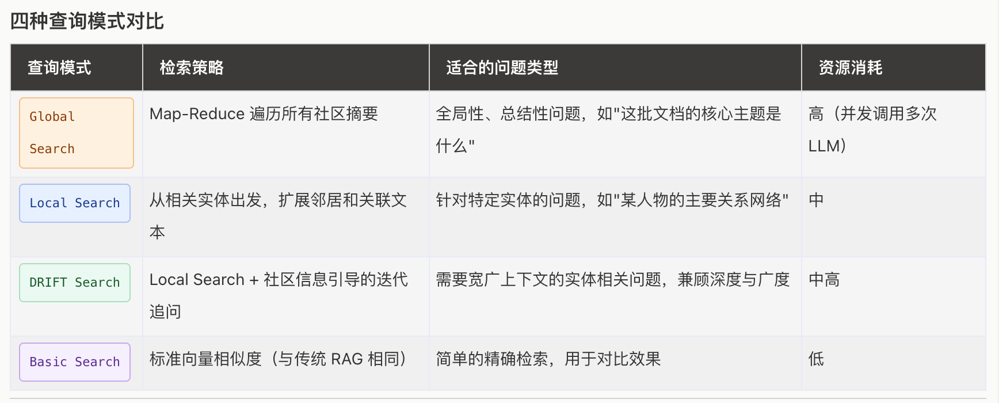

### RAG-知识图库的使用

这一部分也是上下文工程中很重要的一部分。假设这样一种应用场景：拿着一本小说对agent提问：“请问xxx做什么事情是在第几章？”，大模型是没办法回答的。如果将整部小说丢进上下文，一是上下文会溢出，二是token费用也会过高。
所以这里还是预处理的思路：通过向量（Embedding）检索出关键信息，再调用大模型回复。

### RAG方案对比（Native RAG与GraphRAG：知识图谱 + 检索融合）

#### Native RAG

在最开始的时候，基本做法是将文本切片，通过Embedding模型完成对切片的预处理，在查询时通过相似度召回的方式，拿到top3-5的数据，交给大模型理解、再生成回复。
可以参考：[RAG构建](https://github.com/qingpingwang/capcut-agent/blob/main/test/build_rag.py)，这里的好处是：预处理速度快、不需要额外调用大模型对片段做理解。
但是坏处是：效果完全依赖Embedding模型，常面临检索不准确、冗余信息多导致“上下文淹没”等问题，且泛化能力不够。比如提问“主角、主人公”等信息的时候，可能就召回不精准。

#### GraphRAG：知识图谱 + 检索融合

知识图谱相关的信息可以查看：[GraphRAG 使用](https://www.runoob.com/ai-agent/graphrag-usage.html)。
GraphRAG 的核心思路是：不直接检索文本块，而是先建立一张知识图谱，再基于图结构检索。
查询模式支持4种：



需要注意的是：GraphRAG在构建的时候，本身就会调用llm去生成知识图谱。由于GraphRAG的文档网上已经很详细了，我们接下来着重了解一下build的过程做了些什么。

以《斗破苍穹》第一章，构建知识图谱的日志如下：

```log
2026-10-12 10:53:43.0629 - INFO - graphrag.api.index - Initializing indexing pipeline...
2026-10-12 10:53:43.0629 - INFO - graphrag.index.workflows.factory - Creating pipeline with workflows: ['load_input_documents', 'create_base_text_units', 'create_final_documents', 'extract_graph', 'finalize_graph', 'extract_covariates', 'create_communities', 'create_final_text_units', 'create_community_reports', 'generate_text_embeddings']
2026-10-12 10:53:43.0631 - INFO - graphrag.index.run.run_pipeline - Running standard indexing.
2026-10-12 10:53:44.0771 - INFO - graphrag.index.run.run_pipeline - Executing pipeline...
2026-10-12 10:53:44.0771 - INFO - graphrag.index.workflows.create_base_text_units - Workflow started: create_base_text_units
2026-10-12 10:53:47.0178 - INFO - graphrag.index.workflows.create_base_text_units - Starting chunking process for 1 documents
2026-10-12 10:53:47.0190 - INFO - graphrag.index.workflows.create_base_text_units - chunker progress:  1/1
2026-10-12 10:53:47.0195 - INFO - graphrag.index.workflows.create_base_text_units - Workflow completed: create_base_text_units
2026-10-12 10:53:47.0211 - INFO - graphrag.api.index - Workflow create_base_text_units completed successfully
2026-10-12 10:53:47.0212 - INFO - graphrag.index.workflows.create_final_documents - Workflow started: create_final_documents
2026-10-12 10:53:47.0225 - INFO - graphrag.index.workflows.create_final_documents - Workflow completed: create_final_documents
2026-10-12 10:53:47.0225 - INFO - graphrag.api.index - Workflow create_final_documents completed successfully
2026-10-12 10:53:47.0226 - INFO - graphrag.index.workflows.extract_graph - Workflow started: extract_graph
2026-10-12 10:54:49.0684 - INFO - graphrag.logger.progress - extract graph progress: 1/5
2026-10-12 10:55:03.0388 - INFO - graphrag.logger.progress - extract graph progress: 2/5
2026-10-12 10:55:07.0506 - INFO - graphrag.logger.progress - extract graph progress: 3/5
2026-10-12 10:55:31.0107 - INFO - graphrag.logger.progress - extract graph progress: 4/5
2026-10-12 10:55:38.0216 - INFO - graphrag.logger.progress - extract graph progress: 5/5
2026-10-12 10:55:38.0287 - WARNING - graphrag.index.operations.extract_graph.utils - Dropped 11 relationship(s) referencing non-existent entities.
2026-10-12 10:55:38.0334 - INFO - graphrag.logger.progress - Summarize entity/relationship description progress: 1/93
2026-10-12 10:55:38.0334 - INFO - graphrag.logger.progress - Summarize entity/relationship description progress: 2/93
2026-10-12 10:55:38.0334 - INFO - graphrag.logger.progress - Summarize entity/relationship description progress: 3/93
...（省略 Summarize progress 4/93 ~ 92/93）
2026-10-12 10:55:45.0084 - INFO - graphrag.logger.progress - Summarize entity/relationship description progress: 93/93
2026-10-12 10:55:45.0102 - INFO - graphrag.index.workflows.extract_graph - Workflow completed: extract_graph
2026-10-12 10:55:45.0104 - INFO - graphrag.api.index - Workflow extract_graph completed successfully
2026-10-12 10:55:45.0112 - INFO - graphrag.index.workflows.finalize_graph - Workflow started: finalize_graph
2026-10-12 10:55:45.0147 - INFO - graphrag.index.workflows.finalize_graph - Workflow completed: finalize_graph
2026-10-12 10:55:45.0147 - INFO - graphrag.api.index - Workflow finalize_graph completed successfully
2026-10-12 10:55:45.0148 - INFO - graphrag.index.workflows.extract_covariates - Workflow started: extract_covariates
2026-10-12 10:55:45.0148 - INFO - graphrag.index.workflows.extract_covariates - Workflow completed: extract_covariates
2026-10-12 10:55:45.0148 - INFO - graphrag.api.index - Workflow extract_covariates completed successfully
2026-10-12 10:55:45.0148 - INFO - graphrag.index.workflows.create_communities - Workflow started: create_communities
2026-10-12 10:55:45.0247 - INFO - graphrag.index.workflows.create_communities - Workflow completed: create_communities
2026-10-12 10:55:45.0248 - INFO - graphrag.api.index - Workflow create_communities completed successfully
2026-10-12 10:55:45.0248 - INFO - graphrag.index.workflows.create_final_text_units - Workflow started: create_final_text_units
2026-10-12 10:55:45.0275 - INFO - graphrag.index.workflows.create_final_text_units - Workflow completed: create_final_text_units
2026-10-12 10:55:45.0275 - INFO - graphrag.api.index - Workflow create_final_text_units completed successfully
2026-10-12 10:55:45.0276 - INFO - graphrag.index.workflows.create_community_reports - Workflow started: create_community_reports
2026-10-12 10:55:45.0318 - INFO - graphrag.index.operations.summarize_communities.graph_context.context_builder - Number of nodes at level=0 => 15
2026-10-12 10:55:58.0513 - INFO - graphrag.logger.progress - level 0 summarize communities progress: 1/3
2026-10-12 10:56:03.0959 - INFO - graphrag.logger.progress - level 0 summarize communities progress: 2/3
2026-10-12 10:56:15.0403 - INFO - graphrag.logger.progress - level 0 summarize communities progress: 3/3
2026-10-12 10:56:15.0431 - INFO - graphrag.index.workflows.create_community_reports - Workflow completed: create_community_reports
2026-10-12 10:56:15.0433 - INFO - graphrag.api.index - Workflow create_community_reports completed successfully
2026-10-12 10:56:15.0442 - INFO - graphrag.index.workflows.generate_text_embeddings - Workflow started: generate_text_embeddings
2026-10-12 10:56:15.0455 - INFO - graphrag.index.workflows.generate_text_embeddings - Embedding the following fields: ['entity_description', 'community_full_content', 'text_unit_text']
2026-10-12 10:56:21.0058 - INFO - graphrag.index.operations.embed_text.run_embed_text - embedding 29 inputs via 29 snippets using 2 batches. max_batch_size=16, batch_max_tokens=8191
2026-10-12 10:56:42.0794 - INFO - graphrag.logger.progress - generate embeddings progress: 1/2
2026-10-12 10:56:42.0981 - INFO - graphrag.logger.progress - generate embeddings progress: 2/2
2026-10-12 10:56:42.0996 - INFO - graphrag.index.workflows.generate_text_embeddings - Embedded 29 rows for entity_description
2026-10-12 10:56:43.0022 - INFO - graphrag.index.operations.embed_text.run_embed_text - embedding 3 inputs via 3 snippets using 1 batches. max_batch_size=16, batch_max_tokens=8191
2026-10-12 10:56:43.0296 - INFO - graphrag.logger.progress - generate embeddings progress: 1/1
2026-10-12 10:56:43.0301 - INFO - graphrag.index.workflows.generate_text_embeddings - Embedded 3 rows for community_full_content
2026-10-12 10:56:43.0324 - INFO - graphrag.index.operations.embed_text.run_embed_text - embedding 5 inputs via 5 snippets using 1 batches. max_batch_size=16, batch_max_tokens=8191
2026-10-12 10:56:43.0492 - INFO - graphrag.logger.progress - generate embeddings progress: 1/1
2026-10-12 10:56:43.0498 - INFO - graphrag.index.workflows.generate_text_embeddings - Embedded 5 rows for text_unit_text
2026-10-12 10:56:43.0498 - INFO - graphrag.index.workflows.generate_text_embeddings - Workflow completed: generate_text_embeddings
2026-10-12 10:56:43.0556 - INFO - graphrag.api.index - Workflow generate_text_embeddings completed successfully
2026-10-12 10:56:43.0557 - INFO - graphrag.index.run.run_pipeline - Indexing pipeline complete.
2026-10-12 10:56:43.0559 - INFO - graphrag_llm.metrics.log_metrics_writer - Metrics for local/sentence-transformers/paraphrase-multilingual-MiniLM-L12-v2: {
  "failure_rate": 0.0,
  "compute_duration_per_response_seconds": 0.0,
  "cache_hit_rate": 0.0,
  "tokens_per_response": 0.0,
  "cost_per_response": 0.0
}
2026-10-12 10:56:43.0560 - INFO - graphrag_llm.metrics.log_metrics_writer - Metrics for deepseek/deepseek-flash: {
  "attempted_request_count": 25,
  "successful_response_count": 25,
  "failed_response_count": 0,
  "failure_rate": 0.0,
  "requests_with_retries": 0,
  "retries": 0,
  "retry_rate": 0.0,
  "compute_duration_seconds": 520.0954661369324,
  "compute_duration_per_response_seconds": 20.803818645477296,
  "cache_hit_rate": 0.0,
  "streaming_responses": 0,
  "responses_with_tokens": 25,
  "prompt_tokens": 36976,
  "completion_tokens": 92714,
  "total_tokens": 129690,
  "tokens_per_response": 5187.6,
  "responses_with_cost": 25,
  "input_cost": 0.011092800000000005,
  "output_cost": 0.1112568,
  "total_cost": 0.12234959999999999,
  "cost_per_response": 0.004893984
}

```

##### 知识图谱的构建过程

从日志第一行就能看出，build 本质上是一条流水线（pipeline），按顺序执行这几个 workflow：

```text
load_input_documents → create_base_text_units → create_final_documents → extract_graph → finalize_graph
→ extract_covariates → create_communities → create_final_text_units → create_community_reports → generate_text_embeddings
```

按照做的事情，可以归成 7 步：


| 步骤      | workflow                                    | 做了什么                            | 是否调用 llm        | 第一章的结果                     |
| ------- | ------------------------------------------- | ------------------------------- | --------------- | -------------------------- |
| 1. 加载文档 | load_input_documents、create_final_documents | 读取原文，生成文档表                      | 否               | 1 篇文档                      |
| 2. 文本切片 | create_base_text_units                      | 按 600 token 切片，相邻片段重叠 100 token | 否               | 5 个片段（600/600/600/600/471） |
| 3. 抽取图谱 | extract_graph                               | 每个片段让 llm 抽取实体、关系               | 是               | 29 个实体、64 条关系              |
| 4. 合并描述 | extract_graph（Summarize）                    | 同一实体/关系在多个片段出现，描述有多条，交给 llm 合并  | 是               | 93 项，只有 12 项需要调用           |
| 5. 社区划分 | finalize_graph、create_communities           | Leiden 算法，把联系紧密的实体分成社区          | 否               | 3 个社区                      |
| 6. 社区报告 | create_community_reports                    | 每个社区让 llm 写一份结构化报告              | 是               | 3 份报告                      |
| 7. 向量化  | generate_text_embeddings                    | 实体描述、社区报告、原文片段生成向量              | 否（本地 Embedding） | 29 + 3 + 5 条向量             |


`extract_covariates`（抽取声明/事实）默认关闭，所以日志里一闪而过。

**1. 加载文档**

GraphRAG 默认从 input 目录读取 txt/csv/json 文件，我们这里直接把原文以 DataFrame 的形式传进去，跳过了文件读取：

```python
documents = pd.DataFrame([{"id": "chapter-1", "title": "斗破苍穹 第一章", "text": CHAPTER, ...}])
api.build_index(config=config(), input_documents=documents)
```

一部小说可以按章节拆成多篇文档，后续每个片段、实体都能追溯到来自哪一章。

**2. 文本切片**

和 Native RAG 一样，按 token 切片：

```python
chunking={"type": "tokens", "size": 600, "overlap": 100, "encoding_model": "o200k_base"},
```

2842 个字切成了 5 个片段。重叠 100 token 是为了避免一句话被切断在两个片段之间。片段越小，抽取越细致，但调用 llm 的次数也越多。GraphRAG 默认是 1200，我们改小了一些。

**3. 抽取图谱**

这一步是最贵的。GraphRAG 会把每个片段连同 prompt 发给 llm，要求按固定格式返回实体（名称、类型、描述）和关系（源、目标、描述、强度）。实体类型是我们在配置里指定的：

```python
extract_graph={"entity_types": ["person", "organization", "geo", "event", "item"]},
```

默认还会追问一轮“还有没有遗漏的实体”（max_gleanings=1），所以 5 个片段调用了 10 次 llm。日志里的 `Dropped 11 relationship(s) referencing non-existent entities.`，是 llm 抽出的关系引用了不存在的实体，被丢弃了。抽取的结果长这样：

```text
title                    type          frequency  degree
XIAO YAN                 PERSON        3          13
XIAO MEI                 PERSON        2          8
XIAO FAMILY              ORGANIZATION  2          7
TEST MAGIC STONE TABLET  ITEM          1          4
DOU ZHI LI TEST          EVENT         1          6
```

frequency 是出现在几个片段里，degree 是有多少条关系连着它。萧炎 degree=13，说明他是这一章的中心。

**4. 合并描述**

萧炎在 3 个片段里都出现了，就会有 3 条描述，需要 llm 合并成一条。只出现一次的实体不需要合并，直接跳过，所以日志里 93 项大部分是瞬间完成的，真正调用 llm 的只有 12 次。

**5. 社区划分**

这一步不调用 llm，是纯图算法（Leiden 社区发现）：把图里联系紧密的实体聚成一组，类似“朋友圈”。第一章内容少，只有 level 0 一层，3 个社区。小说越长，层级越多，上层社区是下层社区的合并。

**6. 社区报告**

GraphRAG 的精髓在这里。每个社区把实体、关系喂给 llm，生成一份结构化报告（这也是为什么需要 JSON 格式化输出）：

```json
{
    "title": "Xiao Yan, Xiao Xun'er, and the Xiao Family in Wutan City",
    "summary": "This community centers on Xiao Yan, a former child prodigy of the Xiao Family...",
    "rating": 5.0,
    "rating_explanation": "...",
    "findings": [
        {"summary": "Xiao Yan is the central figure in a dramatic decline from prodigy to perceived waste.", "explanation": "..."}
    ]
}
```

全局查询（global_search）用的就是这些报告：先对每份报告做 map（提炼与问题相关的要点、打分），再 reduce 汇总，所以能回答“第一章讲了什么”这种需要通读全文的问题。

**7. 向量化**

最后才是 Native RAG 里的那一步。不同的是，向量化的不只是原文片段，还有实体描述和社区报告。局部查询（local_search）的入口就是实体描述的向量：先找到问题相关的实体，再顺着图把关系、原文片段、社区报告带出来。

**成本**

25 次 llm 调用，约 13 万 token，0.12 美元，耗时 3 分钟（这里只是 2842 字的一章）。可以看到 completion_tokens（9.2 万）远大于 prompt_tokens（3.7 万），因为构建主要是 llm 在“写”。这也是 GraphRAG 最大的问题：构建成本高，整本小说构建一次的费用不可忽视。好在所有 llm 调用结果都会缓存，原文不变时重复构建不再花钱。

##### 生成目录讲解

```text
rag/
├── output/                          # 索引结果，查询时只读这里
│   ├── documents.parquet            # 原文
│   ├── text_units.parquet           # 原文片段，记录每个片段包含哪些实体、关系
│   ├── entities.parquet             # 实体：名称、类型、描述、出现次数、关系数
│   ├── relationships.parquet        # 关系：源、目标、描述、权重
│   ├── communities.parquet          # 社区：层级、父子社区、包含哪些实体
│   ├── community_reports.parquet    # 社区报告：标题、摘要、评分、要点
│   ├── lancedb/                     # 向量库
│   │   ├── entity_description.lance       # 实体描述向量（29 条）
│   │   ├── community_full_content.lance   # 社区报告向量（3 条）
│   │   └── text_unit_text.lance           # 原文片段向量（5 条）
│   ├── stats.json                   # 每个 workflow 的耗时
│   └── context.json                 # 流水线运行状态
├── cache/                           # llm 调用缓存，按 workflow 分目录
│   ├── extract_graph/               # 步骤 3：10 条
│   ├── summarize_descriptions/      # 步骤 4：12 条
│   ├── community_reporting/         # 步骤 6：3 条
│   └── text_embedding/              # 本地 Embedding 不走缓存，为空
└── logs/
    ├── indexing-engine.log          # build 日志，就是上面那份
    └── query.log                    # 查询日志
```

**parquet 和 lancedb 的分工**

parquet 是列式存储的表格文件，可以直接用 pandas 读取。知识图谱的内容（实体、关系、社区、报告）都在这里，表之间通过 id 关联：

```text
documents ──1:n── text_units ──n:n── entities ──n:n── relationships
                                         │
                                    communities ──1:1── community_reports
```

lancedb 里只存 `id + vector`，不存原文。查询时先用向量找到相似的 id，再回 parquet 里取内容。

**查询时用到哪些内容**


| 查询方式               | 向量                 | parquet                                                         |
| ------------------ | ------------------ | --------------------------------------------------------------- |
| 局部查询 local_search  | entity_description | entities、relationships、text_units、communities、community_reports |
| 全局查询 global_search | 不用                 | entities、communities、community_reports                          |


另外两张向量表，text_unit_text 给 basic_search（就是 Native RAG）用，community_full_content 给 drift_search 用，我们暂时没用到。

**注意**：实体和报告都是英文的，原因是 GraphRAG 自带的 prompt 是英文的。查询时 llm 依旧会用中文回答，不影响使用。如果想让图谱也是中文，需要替换 extract_graph、community_reports 的 prompt。

### agent接入RAG

在本次接入中，我们为agent提供一个查询工具，schema中有定义查询范围：

```python
    {
        "type": "function",
        "function": {
            "name": "search",
            "description": "检索小说《斗破苍穹》第一章的内容。用户问到这本书、萧炎或第一章情节时使用。",
            "parameters": {
                "type": "object",
                "properties": {
                    "query": {
                        "type": "string",
                        "description": "检索问题，例如萧炎为什么变成废材",
                    },
                    "global_search": {
                        "type": "boolean",
                        "description": "问整章讲了什么时为 true，查具体情节时为 false",
                    },
                },
                "required": ["query"],
            },
        },
    }
```

global_search字段是非必须的，对应两种查询逻辑：局部查询、全局查询。在全局查询的时候，GraphRAG内部会使用map-reduce的方案去循环获取信息（会消耗更多的Token）。
我们这里把是否需要全局查询的开关交给大模型去判断，最后的测试效果：

```text
> 你好 
你好！我是测试助手，有什么可以帮你的吗？
> 萧炎人怎么样？
call_00_HxYcefhvH0GVlenp5zM81767 search   {  "  query  "  :   "  萧  炎  怎么样  "  ,   "  global  _search  "  :   false  }
result: call_00_HxYcefhvH0GVlenp5zM81767 search {"query": "萧炎怎么样", "global_search": false} # 萧炎怎么样：从天才到“废物”的低谷期

萧炎现在是萧家年轻一辈中的落魄少年。他曾经是极为耀眼的天才：十岁拥有九段斗之气，十一岁凝聚斗之气旋，成为萧家百年来最年轻的斗者，也曾是乌坦城有名的天才少年 [Data: Reports (1); Entities (0, 12); Relationships (27, 28, 1); Sources (1)]。但当前他在斗之力测验中只得到“三段、低级”的结果，被同龄人嘲笑为废物，并被预测将来只会成为家族下层人员 [Data: Reports (1); Entities (0); Relationships (3, 9); Sources (0)]。

## 测验现场与心理状态

测验在广场进行，魔石碑显示他的斗之力为三段、低级；测试员当众公布结果后，人群出现嘲讽骚动，有人说他把家族的脸丢光了，还有人说他能留在家族只是因为族长是他父亲 [Data: Reports (1); Entities (0, 5, 7); Relationships (9, 16, 13); Sources (0)]。萧炎本人感到苦涩、自嘲，认为自己“世界本来就不属于我”，孤单地回到队伍最后一排，之后又走出广场 [Data: Reports (1); Entities (0); Relationships (22, 62); Sources (0, 4)]。

## 家族与制度背景

萧家是萧炎所属的家族，族长是萧炎的父亲；这层父子关系让他尽管表现不佳仍能留在家族中，而不是被直接驱逐 [Data: Reports (1); Relationships (0, 13); Sources (0)]。萧家会为年轻成员组织斗之力/斗之气测试，并依据表现维持内部层级；萧炎被预测为下层成员，而萧媚则被视为种子级天才、重点培养对象 [Data: Reports (1); Relationships (0, 5, 7); Sources (0, 1)]。同一场测试里，萧媚随后测出七段斗之气、高级，并被预测三年内可能成为真正斗者，这与萧炎形成鲜明对比 [Data: Reports (1); Entities (1, 12); Relationships (6, 10, 21, 29); Sources (1)]。

## 关键支持者：萧薰儿

萧薰儿是少数仍尊敬萧炎的人。她恭敬地向他弯腰，称他“萧炎哥哥”，鼓励他放下再拿起、重新站起来，取回属于他的荣耀与尊严，并相信当年的萧炎很吸引人 [Data: Reports (1); Entities (27); Relationships (61); Sources (4)]。当萧炎落寞走出广场时，萧薰儿先站在原地，随后追上去与他并肩而行 [Data: Reports (1); Entities (27, 28); Relationships (61, 62, 63); Sources (4)]。

## 总体评价

综合数据，萧炎目前处于人生低谷：公开测验失败、被嘲笑、被看衰，心理上也孤独自嘲；但他并非毫无资本——他曾是百年最年轻的斗者、乌坦城昔日天才，有族长父亲这层保护，也有萧薰儿这样的坚定支持者 [Data: Reports (1); Entities (0, 12); Relationships (13, 27, 28, 61, 1); Sources (0, 1, 4)]。现有资料只呈现他的落魄与支持者的信念，没有给出他是否以及如何重新崛起。
萧炎目前正处于人生低谷：

- **昔日天才**：十岁九段斗之气，十一岁凝聚斗之气旋，是萧家百年来最年轻的斗者，乌坦城有名的天才少年。
- **如今落魄**：斗之力测验只测出"三段、低级"，被同龄人嘲笑为废物，还被预测将来只能做家族下层人员。他本人也很苦涩自嘲，孤单地退到队伍最后一排。
- **仍有资本**：父亲是族长，让他不至于被驱逐；萧薰儿是少数仍尊敬他的人，唤他"萧炎哥哥"，鼓励他重新站起来、取回属于自己的荣耀。
- **对比鲜明**：同场测试中，萧媚测出七段斗之气、高级，被视为种子级天才。

总的来看，他眼下失意，但并非一无所有——资料只呈现了他的落魄和支持者的信念，还没写到他如何重新崛起。
```

可以看到，查询接口返回的消息还是比较完善的，不仅仅是返回了相关问题，连关联信息也一并带回了。

### 个人思考（agent-仿生）
在agent的开发中，更多的是“人”的指导：模拟人的思考方式去组织上下文。当出现各种各样的问题时，比如RAG召回不准，就要求RAG像人一样思考，而不是仅仅“查字典”：先理清知识库里的人物关系、划分社区，再去回答问题，GraphRAG就是这么做的。包括市面上很多优秀的skills，也都是在模仿优秀的人是怎么做一件事的（俗称“炼化成skills”）。

所以agent的开发，本质上和技术有关系，但关系没那么大了，更多的是对“人”的抽象：优秀的人在面临agent所面临的问题时，会怎么处理？新的处理方案又会带来什么新问题？比如多agent协作时，一个agent越权了怎么办（主从协作、加强约束，不就是职场管理的那一套吗）？

在下一章节中，我们将实现skills的加载，有了skills我们就能插件化的管理agent的能力以及自己的sop了。


```markdown
仓库地址：[https://github.com/qingpingwang/learn](https://github.com/qingpingwang/learn)

交流群（QQ）：[图形/渲染/音视频/AI应用交流群](https://qm.qq.com/q/2d9YzGPNmQ)（523219063）
```

