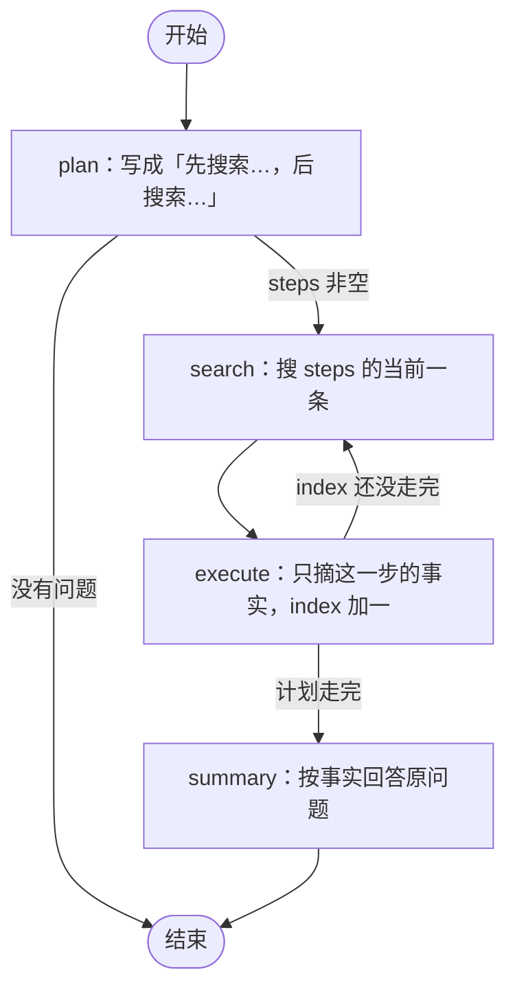

### langchain、langgraph：在 agent 里接入工作流

上一章把子代理派完，agent 开发的基本循环就齐了。再往下不再手搓 ReAct，换成 langchain 和 langgraph。

现在，我们要给agent接一个简单的，可执行的工作流：联网查询工作流：1.根据你的问题先制定查询计划；2.遍历完所有查询计划；3.生成总结返回；

虽然工作流本质上也是一次function-calling的调用，但是内部的工作计划相对于agent来说是**独立**了，这也就意味着：对于**确定性的工作流程、sop**，其实是适合workflow去做的，这样的好处有以下几点：1.**避免模型产生幻觉**，导致执行链路发生偏差；2.**减少大模型的调用**，节约成本，同时执行效更高；3.**最终结果进入上下文**，并不会产生频繁的工具调用进入上下文（有点像独立上下文的subagent）；

**agent**本质上是适合解决**开放性、需要决策性**的问题的。而**workflow**本质上就是做**固定的流程编排**，擅长做**确定性的输入输出**。

### 状态

图上流转的就是这一份状态。问题、计划、当前走到第几步、这一步的搜索结果、已经摘下来的事实、最后的回复，都在里面。节点只返回自己改的那几个字段。

```python
class Research(TypedDict, total=False):
    question: str
    plan: str
    steps: list[str]
    index: int
    hits: str
    notes: list[str]
    reply: str
```

`steps` 是搜索词列表，循环靠 **`index`** 往前走。没有「第一步特殊处理、第二步再特殊处理」。

这里的逻辑是：每次搜索到的消息都会再进入大模型，对消息做一次摘要处理，摘要的结果存在：**`notes`**中。

### 结构化输出

`plan` 要的是搜索词列表，`execute` 要的是这一步的事实。这两处不再让模型写一段自由文本，再自己切。用 langchain 的 `with_structured_output`：传入一个 Pydantic 类，**`invoke` 回来的就是这个类的实例**，字段可以直接读。

`ChatOpenAI` 上这个方法有三种 `method`：

- `function_calling`：把 schema 当成一次工具调用，模型填参数，框架解析成对象。**这里用的是这种。**
- `json_schema`：走 OpenAI 的 Structured Outputs，输出保证贴合 schema。`ChatOpenAI` 不写 `method` 时的默认值。
- `json_mode`：只保证返回一段 JSON。schema 得写进提示词，提示词里还要出现 `json` 这个词，解析失败会抛错。

Pydantic 类的字段说明会进工具参数。模型靠 **`description`** 知道这个字段填什么，所以说明写「什么时候填、没有时留什么」，不要写空话。

计划和摘事实各一个类：

```python
class SearchPlan(BaseModel):
    steps: list[str] = Field(description="按顺序执行的搜索词，后一次可以依赖前一次。最多 3 条。")

class StepFacts(BaseModel):
    facts: list[str] = Field(description="这一步搜索结果里有的事实，每条一句。没有就空列表。")
```

绑一次，后面节点里直接 `invoke`：

```python
plan_model = model.with_structured_output(SearchPlan, method="function_calling")
facts_model = model.with_structured_output(StepFacts, method="function_calling")
```

`plan` 读 `parsed.steps`，再渲染成「先搜索…，后搜索…」。`execute` 读 `parsed.facts`，拼成一条写进 `notes`。列表是空的就记「未查到」。**没有单独的解析函数。**

### 节点流程

整张图四个节点，一条回路。**`plan` 只跑一次**，写好计划。**`search` 和 `execute` 按 `index` 成对往前走**，走完才进 `summary`。




每个节点只动自己那几个字段：


| 节点      | 读                            | 写                                   | 谁来做                                            |
| ------- | ---------------------------- | ----------------------------------- | ---------------------------------------------- |
| plan    | `question`                   | `plan`、`steps`、`index=0`、`notes=[]` | `with_structured_output` 直接给出 `steps`，再渲染成那句计划 |
| search  | `steps[index]`               | `hits`                              | 不调用模型，去 DuckDuckGo 拿标题和摘要                      |
| execute | `plan`、当前搜索词、`hits`          | 往 `notes` 追加一条，`index` 加一           | `with_structured_output` 给出 `facts`，写进 `notes` |
| summary | `question`、`plan`、全部 `notes` | `reply`                             | 模型按事实作答，回复前面带上计划                               |


`search` 失败就留下「没有搜索结果」，图照样往下走。`execute` 系统提示词里贴的就是 `plan` 那几行，所以它知道整份顺序，但**这一轮只处理 `hits`**。

边就这五条。回路只在 `execute` 出来的时候发生：**`index < len(steps)` 回到 `search`，否则去 `summary`**。

```python
graph.add_edge(START, "plan")
graph.add_conditional_edges("plan", route_after_plan)
graph.add_edge("search", "execute")
graph.add_conditional_edges("execute", route_after_execute)
graph.add_edge("summary", END)
```

```python
def route_after_execute(state: Research) -> str:
    if state["index"] < len(state["steps"]):
        return "search"
    return "summary"
```

`summary` **看不到网页，只看见各步摘下来的事实**。没查到的就写没查到。`reply` 是计划加回答，调用方能看见先搜了什么、后搜了什么。

工作流在工具函数里**同步 `invoke`**。`plan`、`search`、`execute`、`summary` 走完，才把 `reply` **整段**作为这次工具的结果交回来。**agent 不会转发工作流内部的输出。** 这里也不需要流式：下一步要用上一步的 `hits` 或 `notes`，只能等这一步结束。

### 接到 agent 上

外层用 langchain 的 `create_agent`。它本身就是一张 langgraph 的图：模型节点、工具节点，来回走到不再调用工具。工作流编译好之后，**当成一个工具挂上去**。

目录还是**只有名称和描述**。图在工具里面，调度助手看不到节点。

```python
def build_workflows(model: BaseChatModel) -> dict:
    return {
        "web-search": {
            "description": "需要联网才能回答的问题。先写成「先搜索…，后搜索…」的计划，再逐步搜索、执行，最后总结。闲聊不要调用。",
            "graph": build_web_search(model),
        },
    }
```

```python
@tool
def run_workflow(name: str, task: str) -> str:
    """执行一个固定工作流。name 使用系统提示词里列出的名称。task 写上用户原话和已经确认的事实。"""
    spec = workflows.get(name)
    if spec is None:
        return f"没有这个工作流，可用的有：{', '.join(workflows)}"
    state = spec["graph"].invoke({"question": task})
    return state.get("reply") or ""
```

通信还是一条。**`task` 字符串下去，`reply` 作为工具结果回来。** 工作流每次都从 `{"question": task}` 起一张新图，**看不到这段对话**，所以上一轮已经确认的事实**必须写进 `task`**。

### 上下文

前几章的 `self.messages` 没有了。对话由 `create_agent` 的 checkpointer 存着。

```python
graph = create_agent(
    model=model,
    tools=[run_workflow],
    system_prompt=system_prompt,
    checkpointer=InMemorySaver(),
)
```

**`context_id` 就是这张图的 `thread_id`。** 每轮只把新的用户消息送进去，框架按这个 id 把历史接上，再送给模型。同一个会话里，它记得上一轮说过什么。

这次**没接第 3 章的压缩**。线程里的消息会一直堆着，直到进程退出。工作流自己也不留状态，**做完即丢**。

### 调用结果

先闲聊一句。这轮没有进工作流：

```text
> 你好
你好！我是测试助手，有什么可以帮你的？

如果你需要查询需要联网才能知道的信息（比如最新新闻、实时数据、某个人/公司/产品的近况等），告诉我具体问题，我会先规划搜索步骤再逐步查证并给你总结。
```

再让它查今天的热点新闻。调度助手没有自己去搜，把原话和已知事实装进 `task`，交给 `web-search`：

```text
> 帮我查一下今天的热点新闻
好的，这属于需要联网查询的问题，我来调用搜索工作流。
call_00_6nhmhJsFXHOTvIEt8JSW8865 run_workflow {"name": "web-search", "task": "用户原话：「帮我查一下今天的热点新闻」。\n\n已知事实：\n- 用户想知道“今天”（即当前日期当天）的热点新闻，关注的是当天发生/发酵的重要事件。\n- 用户未指定地区、领域（如国内/国际、科技/财经/社会/体育等），也未指定新闻条数，默认按国内+国际的热点新闻汇总，按重要程度列举若干条。\n- 用户未提供具体日期，需以当前实际日期为准（以可查证的最新日期为准），并在结果中明确说明新闻对应的日期。\n\n执行计划：先搜索「今日热点新闻 2025年X月X日」（用实际当前日期）获取当日热点概览，再搜索「今日国内要闻」和「今日国际要闻」补充国内、国际两条线，必要时再搜索「今日财经/科技要闻」做补充，最后按重要程度分类汇总，逐条给出事件要点，并标注日期与信息来源。"}
```

`task` 里那版「执行计划」**工作流没有照做**。它只看问题，自己拆成三步。工具结果前面就是这句计划：

```text
result: call_00_6nhmhJsFXHOTvIEt8JSW8865 run_workflow  先搜索 2026年5月7日 热点新闻
后搜索 2026年5月7日 国内要闻
后搜索 2026年5月7日 国际要闻

今天按可查日期是 2026年5月7日，星期四，农历三月廿一。我查到的结果里没有一份完整、权威的“今日热点新闻”总表，下面只汇总搜索结果中能摘录到的事实；未展开或未交叉确认的会标注。

## 一、国内较明确要闻

1. 天舟九号货运飞船受控再入大气层
   - 5月6日16时34分，天舟九号货运飞船顺利撤离空间站组合体，转入独立飞行阶段。
   - 5月7日7时49分，天舟九号受控再入大气层，少量残骸落入预定安全海域。
   - 天舟九号是我国空间站应用与发展阶段发射的第四艘货运飞船，2025年7月15日在文昌航天发射场发射入轨。
   - 来源：今日头条“2026年5月7日今日新闻汇总”、知乎专栏“2026年5月7日新闻联播总结版”。

2. 国内热点总体概览
   - 有结果称当日国内热点为“民生活力迸发，科技外交双线亮眼”，另有“国内热点新闻日报”涵盖财经金融、时政外交、科技进展、社会民生等领域。
   - 但具体条目在当前搜索结果中未展开，具体事实未查到。

## 二、国际较明确要闻

1. 巴西宣布对中国公民免签
   - 巴西政府5月7日宣布，自2026年5月11日起，对持普通护照的中国公民实施免签入境政策，每次入境最长可免签停留30天。
   - 来源：轮子哥Blog，文中标注来源为新华网；本次搜索结果未直接展示新华网原文，需进一步核实。

2. 2026世界杯转播权陷天价僵局
   - FIFA报价2.5亿美元，中印等多国仍未签约。
   - 来源：网易订阅“【每日新闻】2026年5月7日星期四带你看看世界各地发生了什么大事”。

3. 泰国和柬埔寨关系
   - 泰国和柬埔寨领导人同意逐步恢复双边关系。
   - 来源：俄罗斯卫星通讯社档案页摘要；未显示具体发布日期，不能确认一定是5月7日当天。

4. 俄乌相关表态
   - 专家称，泽连斯基使用讹诈手段，其目的是指控俄罗斯违反停火协议。
   - 来源：俄罗斯卫星通讯社；属单一来源/专家观点，需谨慎看待。

5. 全球议题泛盘点
   - 有文章概括称，2026年5月7日国际社会面临极地冰川融化引发的自然灾害、欧洲内部极右翼思潮抬头、地缘政治冲突升级、全球生物多样性关注等挑战。
   - 来源：英语易可。内容较泛，未给出具体事件细节。

## 三、热榜/待核实话题

以下来自知乎热榜日报、Anyknew 等，只看到标题或摘要，未查到完整事实、时间地点和权威来源：

- 南非洪水中的鳄鱼食人惨案
- 王心凌演唱会激光灼伤事件
- 中美科技脱钩相关话题
- 531户小区仅25户交物业费致电梯停运
- 老人去世前几年是否特别“作”的讨论
- 央视硬刚国际足联拒绝天价世界杯转播合同

## 小结

今天可确认度较高的是：天舟九号受控再入大气层；国际方面较具体的是：巴西对华免签、世界杯转播权天价僵局。其余多为聚合摘要或热榜话题，未查到完整经过，也未完成权威通讯社交叉确认。
```

调度助手没有改搜索顺序，把这份结果又转述了一遍：

```text
已经查好了，下面是汇总（按可查日期为 2026年5月7日，星期四）：

## 一、国内要闻

天舟九号货运飞船受控再入大气层
- 5月6日16时34分顺利撤离空间站组合体，转入独立飞行阶段。
- 5月7日7时49分受控再入大气层，少量残骸落入预定安全海域。
- 它是我国空间站应用与发展阶段发射的第四艘货运飞船，2025年7月15日由文昌航天发射场发射入轨。
- 来源：今日头条新闻汇总、知乎专栏新闻联播总结版

另有聚合类结果概括当日国内热点为“民生活力迸发，科技外交双线亮眼”，涵盖财经金融、时政外交、科技进展、社会民生等领域，但具体条目未展开。

## 二、国际要闻

1. 巴西宣布对中国公民免签——5月7日宣布，自2026年5月11日起对持普通护照中国公民免签入境，每次最长停留30天。（转载自新华网，未直接看到原文，建议再核实）
2. 2026世界杯转播权陷天价僵局——FIFA报价2.5亿美元，中印等多国仍未签约。
3. 泰国和柬埔寨关系——两国领导人同意逐步恢复双边关系。（来源未显示具体发布日期，无法确认就是当天）
4. 俄乌相关表态——有专家称泽连斯基使用讹诈手段，目的是指控俄违反停火协议。（单一来源、专家观点，需谨慎看待）

## 三、待核实的热榜话题

以下只查到标题或摘要，未找到完整事实与权威来源：南非洪水鳄鱼食人事件、王心凌演唱会激光灼伤、中美科技脱钩相关话题、531户小区仅25户交物业费致电梯停运、央视拒绝天价世界杯转播合同等。

## 小结

可确认度较高的是：天舟九号受控再入大气层；国际方面较具体的是巴西对华免签和世界杯转播权僵局。其余多为聚合摘要或热榜话题，尚未完成权威通讯社交叉核实。

需要我针对其中某条（比如巴西免签、世界杯转播权）单独深挖核实吗？
```

到这里，agent 和工作流的接缝就清楚了：**开放的判断留在 `create_agent`，固定的步骤留在 `StateGraph`。**

其实可以看到：对agent来说，不同的工作流，实际上也就是对应**一次工具调用**。所以对llm、agent来说，一切的基础都是：**function-calling**。

仓库地址：[https://github.com/qingpingwang/learn](https://github.com/qingpingwang/learn)

交流群（QQ）：[图形/渲染/音视频/AI应用交流群](https://qm.qq.com/q/2d9YzGPNmQ)（523219063）
