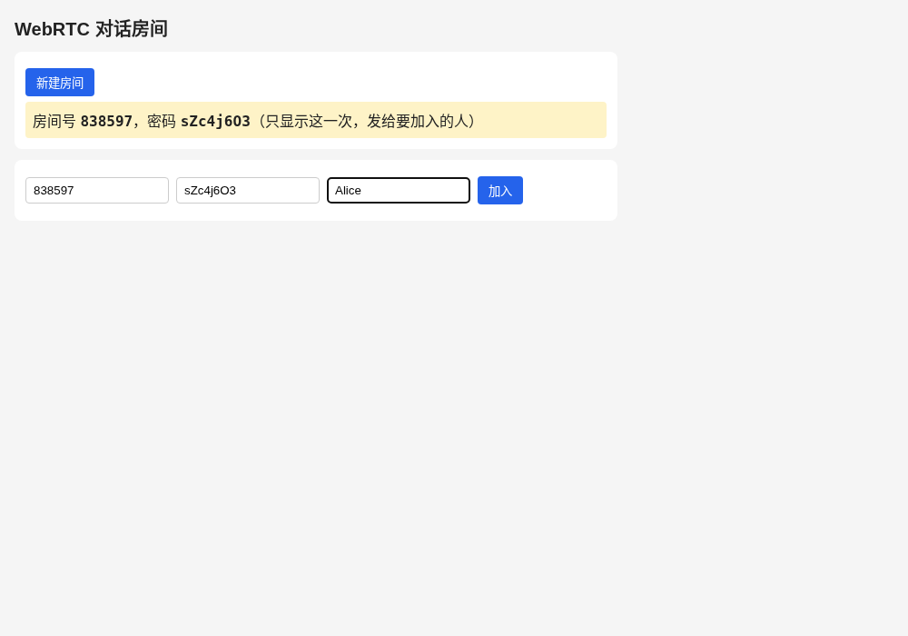
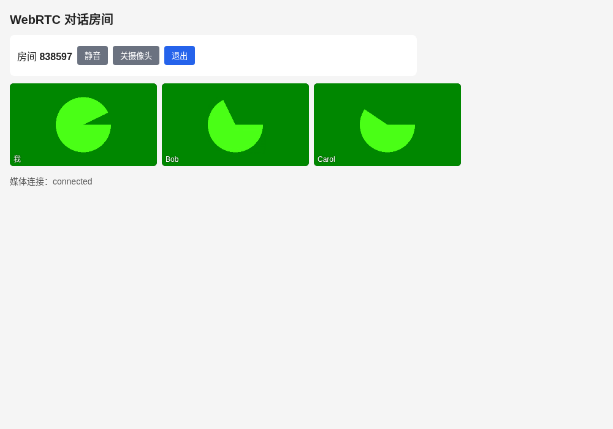

### 实时音视频对话房间：FastAPI 信令 + aiortc SFU

WebRTC 这部分做一个 Web 端的对话房间：网页上新建房间，服务器生成密码，拿到房间号和密码的人进同一个房间音视频通话。只做音视频，不做文字。

- **信令**：FastAPI + WebSocket，转发 offer、answer、ICE 候选，按房间号广播进出；
- **媒体**：SFU 思路，每个人只和服务器建一条连接，服务器用 aiortc 把每个人的音视频转给房间里的其他人；
- **画面**：统一不超过 640x360、15 帧，小窗网格显示。

线上地址：[https://wangqingping.top/webrtc](https://wangqingping.top/webrtc)

### 目录

和 workflow 一样，一个组件一个目录，下面放启动脚本和代码：

```text
webrtc/
├── room/
│   ├── run.sh          # 建 venv、装依赖、后台启动 uvicorn，默认 127.0.0.1:8090
│   ├── stop.sh
│   ├── server/         # 后端：FastAPI 信令 + aiortc SFU
│   │   ├── server.py
│   │   └── requirements.txt
│   └── web/            # 前端：纯 HTML + JS，不用框架
│       ├── index.html
│       ├── app.js
│       └── style.css
└── markdown/
    ├── lessons1.md
    └── res/
```

`pid/`、`log/`、`.venv/` 是运行时生成的，不进仓库。

前后端分成两个目录。后端只认 `WEBRTC_WEB_DIR`（相对 `server/`，默认 `../web`）这一个前端目录，把它挂成静态文件；所有地址都在 `/webrtc` 下：

| 地址 | 内容 |
| --- | --- |
| `/webrtc` | 页面 `web/index.html` |
| `/webrtc/app.js`、`/webrtc/style.css` | 前端静态文件 |
| `POST /webrtc/api/rooms` | 新建房间 |
| `GET /webrtc/api/config` | STUN 地址 |
| `/webrtc/ws` | 信令 WebSocket |

本地 `./run.sh` 后打开 `http://127.0.0.1:8090/webrtc`。`getUserMedia` 只在 HTTPS 或 localhost 下可用，本地用 localhost，线上用站点已有的 HTTPS 域名。



### 新建房间和密码

`POST /webrtc/api/rooms`：

- 房间号：6 位数字，`secrets.randbelow` 生成，不和已有房间重复；
- 密码：`secrets.token_urlsafe(6)`，8 个字符；
- 密码只在这个接口的响应里出现一次，页面显示给创建者，服务器之后只用来校验。

加入时，WebSocket 连上后第一条消息带房间号和密码：

```json
{"type": "join", "room": "838597", "password": "sZc4j6O3", "name": "Alice"}
```

服务器用 `secrets.compare_digest` 比对密码，错了回 `{"type": "error"}` 并断开。房间存在内存里，最后一个人离开就删掉；建了没人进的房间 10 分钟后回收。默认最多 20 个房间、每个房间 4 人。

### 信令

| 方向 | 消息 | 说明 |
| --- | --- | --- |
| 客户端 → 服务器 | `join` | 房间号、密码、昵称 |
| 服务器 → 客户端 | `joined` | 自己的 id、房间里已有的人 |
| 服务器 → 房间其他人 | `join` / `leave` | 有人进来、有人离开 |
| 服务器 → 客户端 | `offer` | SDP，加上 `upload`（上行两路的 mid）和 `mids`（每一路下行来自谁） |
| 客户端 → 服务器 | `answer` | SDP |
| 客户端 → 服务器 | `candidate` | 浏览器的 ICE 候选，逐个转发（trickle） |

服务器这边的 ICE 候选不单独发：aiortc 不支持 trickle，在 `setLocalDescription` 时收集完，直接写在 offer 的 SDP 里。

前端的 `onmessage` 用一个 Promise 队列逐条处理信令。不排队的话，服务器的 answer 和紧接着的新 offer 会同时操作 `RTCPeerConnection`，浏览器报状态错误。

### 协商：始终由服务器发 offer

最开始是浏览器发第一个 offer、服务器回 answer，之后有人进出再由服务器发 offer。这样在 Chrome 上第二次协商失败：

```text
Failed to set remote offer sdp: RTP extension ID reassignment not supported
```

原因是第一次协商用的是 Chrome 分配的 RTP 头扩展 ID，aiortc 自己发 offer 时换成了自己的一套，Chrome 不允许中途改。改成每次都由服务器发 offer，两边一直用 aiortc 的那套 ID：

1. 有人加入，服务器先开两个只收（`recvonly`）的 transceiver，音频、视频各一个，作为他的上行；
2. 服务器发 offer，`upload` 里写上这两路的 mid；
3. 浏览器 `setRemoteDescription` 后对本地音视频轨道各调一次 `addTrack`。`addTrack` 会复用同类型里第一个还没发过东西的 transceiver，也就是服务器开好的那两路；前端再核对一遍 mid 和 `upload` 一致，然后回 answer；
4. 之后房间里有人进出，服务器在同一条连接上增减下行，再发 offer。

每个参与者一把 `asyncio.Lock`，一次只跑一轮协商，等到 answer 才放开；15 秒没回 answer 就放弃这一轮。

### 上行：360p 小画面

```js
const MEDIA = {
  audio: true,
  video: { width: { ideal: 640, max: 640 }, height: { ideal: 360, max: 360 }, frameRate: { ideal: 15, max: 15 } },
};
local = await navigator.mediaDevices.getUserMedia(MEDIA);
// 收到服务器第一个 offer 后
for (const track of local.getTracks()) pc.addTrack(track, local);
```

协商完后再用 `sender.setParameters` 把视频的 `maxBitrate` 设成 500 kbps、`maxFramerate` 设成 15。页面上每个人一个 240x135 的小窗，网格排列，没有放大的主画面。

### 下行：MediaRelay 转发

服务器收到某人的 answer 后，从上行 transceiver 的 `receiver.track` 拿到他的音视频轨道，然后让房间里的其他人各自重新协商：

```python
for track, src in wanted.items():
    if track not in peer.forwarded:
        transceiver = peer.pc.addTransceiver(relay.subscribe(track), direction="sendonly")
        peer.forwarded[track] = (transceiver, src)
```

- `MediaRelay.subscribe` 给每个订阅者一份独立的代理轨道，源轨道只读一次；
- 每一路下行一个只发的 transceiver，offer 里的 `mids` 告诉前端这个 mid 是谁的，前端按来源把轨道归成一个 `MediaStream`，一人一个小窗；
- 有人离开，他的源轨道结束，转给别人的那几路 sender 也停了，这几路改成 `inactive`，不再复用。

aiortc 的转发要先解码再重新编码，每个订阅者编码一份，和 mediasoup、LiveKit 那种只转发 RTP 包的 SFU 不一样，编码路数随人数平方增长，所以每个房间限制 4 人。



### ICE 和 STUN

浏览器和 aiortc 都用 STUN 拿自己的公网地址。`stun.l.google.com` 在国内不稳定，默认用 `stun:stun.miwifi.com:3478`，可以用环境变量 `WEBRTC_STUN` 改；aiortc 只用列表里的第一个。没有部署 TURN。

### 部署到个人网站

flask-web 里放一份同样结构的 `webrtc_room/`（`run.sh`、`stop.sh`、`server/`、`web/`），服务器上 `git pull` 后执行 `webrtc_room/run.sh`，FastAPI 监听 `127.0.0.1:8090`。

站点的 nginx 把 `/webrtc`、`/webrtc/` 转给 8090，`/webrtc/ws` 额外带上 WebSocket 升级头：

```nginx
location = /webrtc/ws {
    proxy_pass http://127.0.0.1:8090;
    proxy_http_version 1.1;
    proxy_set_header Upgrade $http_upgrade;
    proxy_set_header Connection "upgrade";
    proxy_set_header Host $host;
    proxy_read_timeout 3600s;
}

location = /webrtc { proxy_pass http://127.0.0.1:8090; }
location /webrtc/  { proxy_pass http://127.0.0.1:8090; }
```

站点 nginx 有一条 `rewrite ^/(.+)/$ /$1 permanent;`，`/webrtc/` 会被重定向到 `/webrtc`，所以后端对 `/webrtc` 单独返回 `index.html`，前端引用资源都写成 `/webrtc/...` 的绝对路径。

### 云服务器的 UDP

aiortc 的媒体走 UDP，端口随机。在云服务器上测下来：

- 服务器自己出去访问 STUN 正常，映射出来的公网端口和本地端口一致；
- 从外面往服务器的 UDP 端口发包收不到，服务器上 `ufw` 没开，挡住的是云厂商的安全组；
- 测试用的 Mac 所在网络是对称型 NAT，访问两个不同 STUN 服务器映射出两个不同端口，服务器没法反向打洞。

安全组不放开 UDP 时，服务器收不到浏览器的连通性检查，ICE 停在 `checking`。线上房间要能通话，需要在安全组里放开 UDP 入站（aiortc 没有端口范围配置，用的是系统的临时端口段）。

本地用三个 Chrome（假摄像头）测试：三个人互相都能看到对方，画面都是 640x360，有人离开后对应的小窗消失；密码错误会提示"房间号或密码错误"。

仓库地址：[https://github.com/qingpingwang/learn](https://github.com/qingpingwang/learn)

交流群（QQ）：[图形/渲染/音视频/AI应用交流群](https://qm.qq.com/q/2d9YzGPNmQ)（523219063）
