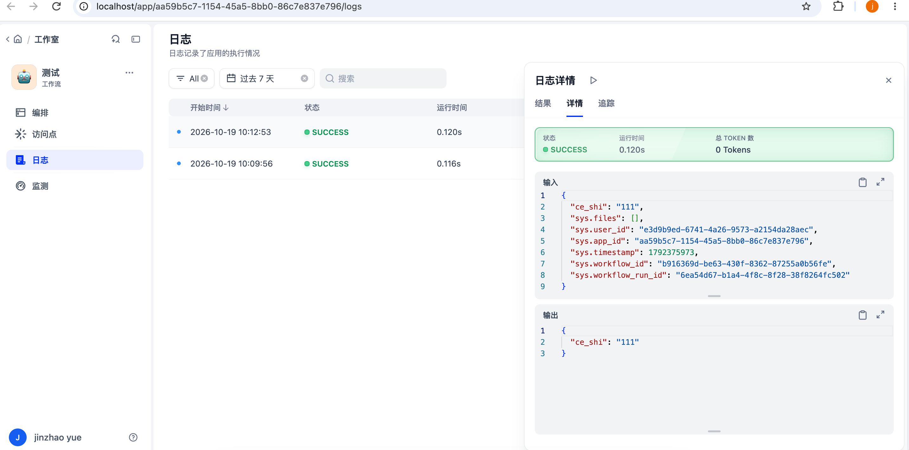
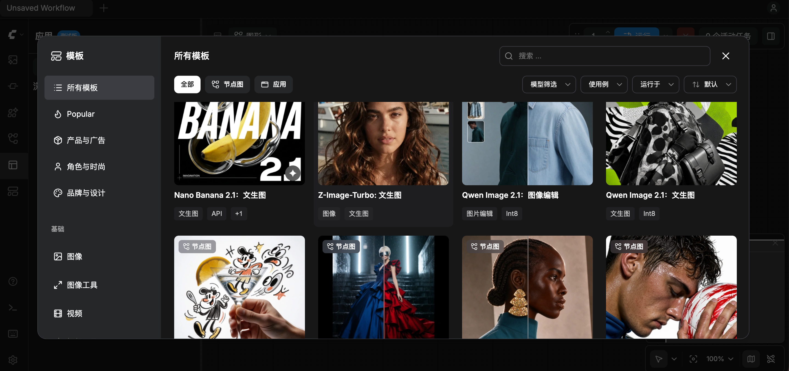
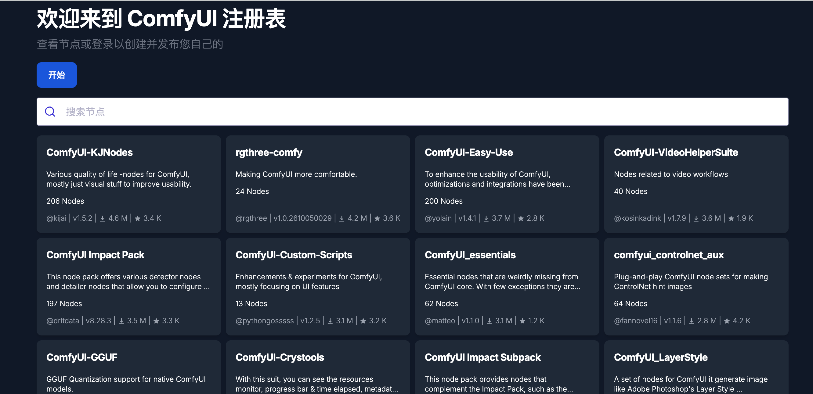

### 本地搭建篇：Dify 和 ComfyUI

workflow 这部分，把 Dify 和 ComfyUI 在本地跑起来，并对比两者各自适合的场景。

- **Dify**：搭工作流、对外提供服务的平台，带账号、权限、日志、API；
- **ComfyUI**：本地跑生成模型的节点引擎，用来做出图、出视频的流水线。

### Dify 本地搭建

源码用 submodule 拉到 `workflow/dify/dify`，固定在 `1.17.1`。部署用仓库自带的 `docker/docker-compose.yaml`。

`run.sh`：

1. 用 colima 起一个叫 `dify` 的 profile（4 核、8G 内存、60G 磁盘）；
2. `docker/.env` 不存在时，从 `.env.example` 复制一份；
3. `docker compose up -d`；
4. 轮询 `http://localhost/console/api/setup`，返回正常即启动完成。

`stop.sh`：先 `docker compose stop`，再 `colima stop dify`。

默认配置（weaviate、postgresql、开启协同）下一共 16 个服务，用到 12 个镜像：

| 服务 | 作用 |
| --- | --- |
| `api` / `worker` / `worker_beat` / `api_websocket` | 同一个 `dify-api` 镜像：后端接口、Celery 异步任务、定时任务、画布协同的 WebSocket |
| `web` | 前端控制台 |
| `nginx` | 反向代理，统一走 80 端口 |
| `db_postgres` / `redis` | 业务数据库、缓存和队列 |
| `weaviate` | 知识库的向量库 |
| `plugin_daemon` | 插件运行时，模型供应商、工具都是插件 |
| `sandbox` | 代码节点的沙箱 |
| `agent_backend` / `local_sandbox` | Agent 后端和它的本地沙箱 |
| `ssrf_proxy` / `agent_ssrf_proxy` | 两个 squid 代理，防止沙箱、HTTP 请求访问内网 |
| `init_permissions` | 启动时修正目录权限，执行完退出 |

### Dify 适合什么：内部工作流

Dify 适合搭**内部工作流**：把固定的 SOP 在画布上编排好，**发布成 API** 给其他业务系统调用；源码里有 `api/controllers/mcp/`，也可以**发布成 MCP 服务**给 agent 当工具。也就是把公司的公共能力抽象出来。

### difyctl

Dify 有两个 CLI：`dify` 用于开发插件，`difyctl` 用于管理和运行应用。

`difyctl` 走 OpenAPI，需要在 `docker/.env` 里加两项并重启：

```bash
OPENAPI_ENABLED=true
ENABLE_OAUTH_BEARER=true
```

登录用 OAuth 设备码：`difyctl auth login` 给出链接和验证码，在浏览器里确认。

查看、运行应用：

```bash
$ difyctl get app
NAME  ID                                    MODE      UPDATED
测试  aa59b5c7-1154-45a5-8bb0-86c7e837e796  workflow  2026-10-19T02:10:22.462973

$ difyctl run app aa59b5c7-1154-45a5-8bb0-86c7e837e796 --inputs '{"ce_shi":"111"}' -o json
{
  "mode": "workflow",
  "event": "workflow_finished",
  "workflow_run_id": "189dda6e-0109-47b3-8854-647fd821c9a4",
  "data": {
    "status": "succeeded",
    "outputs": {
      "ce_shi": "111"
    },
    "error": null,
    "elapsed_time": 0.117799,
    "total_steps": 2,
    ...
  }
}
```

常用调用方式（`difyctl run app --help`）：

```bash
# 先查 id、mode 和输入变量
difyctl get app -o json
difyctl get app -A -o json            # 所有工作空间
difyctl describe app <id> -o json     # 输入变量定义

# workflow：输入变量放 --inputs
difyctl run app <id> --inputs '{"key":"value"}' -o json
difyctl run app <id> --inputs-file inputs.json

# chat / agent-chat / advanced-chat / completion：直接传消息
difyctl run app <id> "hello"
difyctl run app <id> "继续" --conversation <conversation_id>   # 接着已有会话

# 文件输入：本地文件或 URL，可重复
difyctl run app <id> --file doc=@./report.pdf
difyctl run app <id> --file img=https://cdn.example.com/logo.png

# 其他
difyctl run app <id> --stream                  # 流式输出
difyctl run app <id> --think                   # 打印模型思考过程（输出到 stderr）
difyctl run app <id> --workflow-id <version>   # 指定已发布的工作流版本
difyctl run app <id> --retry-on-limit          # 遇到 429 等待重试

# 工作流停在人工输入节点时，返回 status "paused" 和 form_token，用 resume 继续
difyctl resume app <id> <form_token> --workflow-run-id <run_id> --inputs '{"name":"Alice"}'
```

画布的运行历史里只有在画布上点"运行"的调试记录，CLI 的执行记录在应用左侧的**日志**页：



能力范围（1.17.1 的 `difyctl --help`）：

- **登录与账号**：`auth login`、`auth whoami`、`auth devices`（管理、吊销登录设备）；`use host` / `use account` / `use workspace` 切换实例、账号、工作空间；
- **应用**：`get app`、`describe app`、`run app`（`-o json|yaml`），`resume app` 恢复停在人工输入节点的工作流；
- **导入导出**：`export studio-app` / `import studio-app`，应用与 DSL（YAML）互转；
- **成员与工作空间**：`get workspace`，`get member` / `create member` / `set member` / `delete member`；
- **Agent**：`skills install` 把 difyctl 的 SKILL.md 装进本机 coding agent，`difyctl help agent` 输出给 agent 的命令约定；
- **其他**：`config`、`env list`、`version`。

命令里没有编辑节点和连线、知识库、插件、模型供应商相关的操作，这些在网页上做，或改 DSL 后导入。

### Dify 的 B 端能力

- **成员和角色**：`api/models/account.py` 的 `TenantAccountRole` 定义了 `owner`、`admin`、`editor`、`normal`、`dataset_operator`；
- **API Key**：按应用发放；
- **日志**：每次运行的输入输出都有记录；
- **私有化部署**。

社区版默认不允许新建工作空间（`ALLOW_CREATE_WORKSPACE=false`）。协议是修改过的 Apache 2.0：用源码运营多租户服务（一个工作空间算一个租户）需要商业授权；使用其前端时不能去掉或修改控制台的 LOGO 和版权信息。

接飞书做权限：

- 身份：飞书 OAuth 登录，通讯录 API 同步组织架构，订阅变更事件处理离职、调岗；
- 功能权限：RBAC（用户、角色、权限码）；
- 资源权限：具体工作流、模型用 ACL 单独授权；
- 数据权限：按本人、本部门、全部划分，部门树来自飞书。

### Dify 不适合什么：无限画布创作

Dify 的画布基于 React Flow，用于编排，不是创作画布：

- 插件节点只能用 Python 写，前端是按配置自动生成的表单，做不了图片预览、视频时间线这类交互；
- 原生节点要前后端一起改：前端在 `web/app/components/workflow/nodes/` 下加组件并注册，后端在 `api/` 里加节点逻辑。

生图、生视频节点可以接，但在画布上看图、改图、接着做下一步的创作交互，Dify 不支持。

### ComfyUI 本地搭建

源码用 submodule 拉到 `workflow/comfyui/ComfyUI`，固定在 `v0.41.3`。

`run.sh`：

1. 首次运行用 uv 建虚拟环境：`uv venv .venv --python 3.13`，再 `uv pip install -r requirements.txt`；
2. 后台启动 `main.py --listen 127.0.0.1 --port 8188`，pid 写到 `pid/`，日志写到 `log/`；
3. 轮询 `/system_stats`，返回正常即启动完成。

`stop.sh`：按 pid 文件结束进程。

没用 pip 的原因：pip 的 truststore 会读 `platform.mac_ver()`，这里返回空字符串，`int('')` 报错。另外清华源缺一个 workflow templates 的素材包，所以用的是官方 PyPI。

M1 上日志显示 `Device: mps`，PyTorch 走 MPS 加速。

### ComfyUI 适合什么：本地部署、现成节点、节点市场

- **本地部署**：模型、素材、输出都在本机；
- **调用现成节点**：加载模型、采样、ControlNet、放大等，连起来就是出图、出视频的流水线；内置**模板库**有现成工作流，打开即可运行；
- **节点市场**：第三方节点包在 [Comfy Registry](https://registry.comfy.org) 上搜索，或通过 ComfyUI-Manager 安装。





这个版本里 ComfyUI-Manager 是可选组件：先装 `manager_requirements.txt` 的依赖，再加 `--enable-manager` 启动。当前 `run.sh` 没开。

开源版没有 B 端能力：没有账号、角色权限、团队空间、审计；`--multi-user` 只是按用户分开存储，也没有多人实时协同。

### 自定义节点包

节点包是 `custom_nodes/` 下的一个 Python 包，里面可以有多个节点。

两种写法：

- **老写法**：`INPUT_TYPES` 声明输入，`RETURN_TYPES` 声明输出，`FUNCTION` 指定执行方法，在 `NODE_CLASS_MAPPINGS` 里注册；
- **新写法**：继承 `io.ComfyNode`，`define_schema` 描述输入输出，`execute` 执行，`comfy_entrypoint` 返回扩展（见 `custom_nodes/example_node.py.example`）。

前端扩展：包里设置 `WEB_DIRECTORY`，目录下的 JS 会作为前端扩展加载。

ComfyUI 启动时扫描 `custom_nodes/`，通过 `/object_info` 把节点定义下发给前端，前端按定义渲染节点，后端加节点不用改前端代码。

常见节点包：

- ComfyUI-KJNodes：图像、遮罩、批处理等杂项工具节点；
- rgthree-comfy：分组、开关、执行进度等易用性增强；
- ComfyUI-Easy-Use：把常用节点组合封装；
- [ComfyUI-VideoHelperSuite](https://github.com/Kosinkadink/ComfyUI-VideoHelperSuite)：视频读取、拆帧、合成；
- [ComfyUI-Impact-Pack](https://github.com/ltdrdata/ComfyUI-Impact-Pack)：检测、分割、局部重绘；
- [comfyui_controlnet_aux](https://github.com/Fannovel16/comfyui_controlnet_aux)：ControlNet 预处理器；
- ComfyUI-GGUF：加载 GGUF 量化模型。

安装方式：ComfyUI-Manager、Comfy Registry，或 `git clone` 到 `custom_nodes/` 后装依赖。

需要注意：每个包有自己的 `requirements.txt`，容易和 torch 等依赖冲突；质量参差不齐；节点包是任意 Python 代码，有安全风险。

### 对比

| | Dify | ComfyUI |
| --- | --- | --- |
| 定位 | 搭工作流、对外服务的平台 | 本地跑生成模型的节点引擎 |
| 部署 | docker compose，16 个服务 | 一个 Python 进程 |
| 扩展节点 | 插件只写 Python，界面是自动表单；原生节点要前后端一起改 | 节点包，定义经 `/object_info` 下发，可用 JS 扩展前端 |
| 对外调用 | API / MCP，`difyctl` | `/prompt` 接口 |
| B 端能力 | 成员、角色、API Key、日志 | 无 |
| 适合 | 内部工作流、抽象公共能力 | 出图、出视频的生成流水线 |

仓库地址：[https://github.com/qingpingwang/learn](https://github.com/qingpingwang/learn)

交流群（QQ）：[图形/渲染/音视频/AI应用交流群](https://qm.qq.com/q/2d9YzGPNmQ)（523219063）
